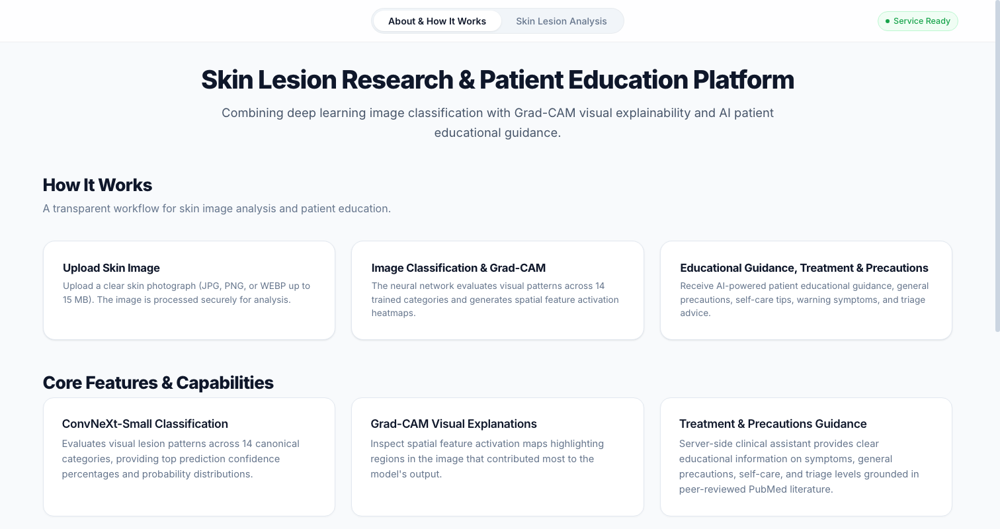
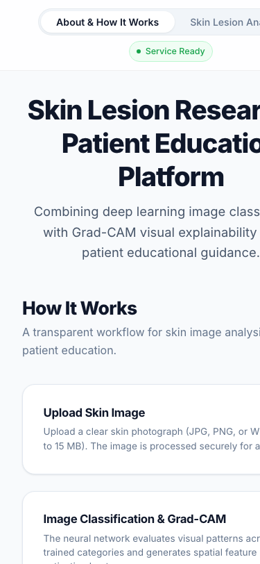

# Skin Lesion Research & Explainable AI Platform

[](https://www.python.org/)
[](https://fastapi.tiangolo.com/)
[](https://pytorch.org/)
[](https://react.dev/)
[](https://vitejs.dev/)

> **RESEARCH & EDUCATIONAL DEMONSTRATION ONLY**  
> This system is an academic research demonstration and educational platform. It is **not** a certified medical device, does **not** provide clinical diagnosis, and must **not** be used as a substitute for professional evaluation by a qualified dermatologist or physician.

---

## Overview

The **Skin Lesion Research & Explainable AI Platform** is an end-to-end medical deep-learning application designed to explore interpretable classification of dermatological imagery. Dermatological computer-vision systems frequently struggle with user trust due to the "black-box" nature of deep neural networks. This platform pairs state-of-the-art vision architectures with visual saliency mechanisms, predictive uncertainty estimation, automated image-quality triage, and patient-centered educational guidance.

The application allows users to upload dermoscopic images, runs pre-inference image-quality screening, computes calibrated class probabilities using a fine-tuned **ConvNeXt-Small** network, renders **Grad-CAM** visual attention heatmaps with localized lesion bounding boxes, estimates prediction margin uncertainty, and synthesizes clinical literature from PubMed.

---

## Key Features

- **Dermoscopic Image Upload & Interactive Previews**: Drag-and-drop or file-selector input with real-time browser preview, image dimension checks, and sample test image loading.
- **Pre-Inference Quality Screening**: Automated heuristic checks evaluate sharpness (Laplacian variance), mean illumination, contrast (RMS), and minimum spatial resolution before inferencing. Images failing criteria trigger non-blocking quality gate warnings.
- **Deep-Learning Lesion Classification**: Multi-class probability distribution computed across dermoscopic classes with temperature-scaled calibration.
- **Explainable AI (Grad-CAM Saliency)**: Target-layer gradient activation mapping (`stages.3.blocks.2.norm` in ConvNeXt-Small) generating localized heatmap overlays and extracted bounding boxes indicating regions influencing model attention.
- **Predictive Uncertainty Assessment**: Uncertainty estimation derived from prediction margin and distribution entropy, explicitly flagging borderline or low-confidence samples.
- **Biomedical Literature Retrieval**: Live querying and deduplication of peer-reviewed articles from the NCBI PubMed Entrez API for the predicted lesion class.
- **Patient Educational Guidance**: Structured educational summaries explaining condition characteristics, typical clinical appearance, and the ABCDE melanoma screening framework powered by server-side LLM synthesis.
- **Enterprise-Grade Observability & Security**: Pydantic v2 data validation, production CORS origin whitelisting, and Prometheus `/metrics` endpoint secured via Bearer token authentication.

---

## Visual Interface & Architecture Evidence

The frontend delivers an accessible, high-contrast, responsive interface built specifically for clinical research demonstration:

| Desktop Analysis & Explainability View | Responsive Mobile Interface |
| :---: | :---: |
|  |  |
| *Full-width diagnostic dashboard with Grad-CAM inspection* | *Adaptive single-column layout on 390px mobile viewport* |

> *Note: Genuine runtime screenshots are captured in `audits/final_presentation/evidence/` documenting desktop (1440px) and mobile (390px) verified states.*

---

## System Architecture

```mermaid
flowchart TD
    subgraph Frontend["React 18 + Vite Frontend (Port 5173)"]
        UI["Image Upload & Control UI"]
        Display["Diagnostic & Saliency Display"]
        Educate["Literature & Patient Guidance Panel"]
    end

    subgraph Backend["FastAPI REST Service (Port 8001)"]
        Router["API Gateway / Routers"]
        Quality["Image Quality Gate (Laplacian / Contrast)"]
        
        subgraph Engine["Inference & Explainability Engine"]
            ConvNeXt["ConvNeXt-Small (PyTorch MPS/CPU)"]
            GradCAM["Grad-CAM LayerNorm Hooks"]
            Calibrate["Temperature Scaling & Uncertainty"]
        end

        subgraph External["External Services"]
            PubMed["NCBI PubMed Entrez API"]
            LLM["Groq Cloud API (Llama-3.3-70b)"]
        end
    end

    UI -->|Multipart POST /api/v1/predict| Router
    Router --> Quality
    Quality --> ConvNeXt
    ConvNeXt --> Calibrate
    Calibrate -->|Probabilities & Uncertainty| Display

    UI -->|Multipart POST /api/v1/explain| Router
    Router --> GradCAM
    GradCAM -->|Heatmap Overlay & Bounding Box| Display

    Display -->|GET /api/v1/research/{condition}| Router
    Router --> PubMed
    PubMed --> Educate

    Display -->|POST /api/v1/guidance| Router
    Router --> LLM
    LLM --> Educate
```

---

## Technology Stack

### Frontend
- **Framework**: React 18.3 (JavaScript, JSX)
- **Bundler & Dev Server**: Vite 5+
- **Styling**: Vanilla CSS3 Custom Properties (Design System Tokens)
- **Icons**: Lucide React
- **HTTP Client**: Native Fetch API with structured service wrappers

### Backend & API
- **Framework**: FastAPI 0.110+
- **ASGI Server**: Uvicorn (standard workers)
- **Validation & Settings**: Pydantic v2 & Pydantic-Settings
- **Metrics & Observability**: Prometheus Client (Bearer-token protected)

### Deep Learning & Computer Vision
- **Model Framework**: PyTorch 2.2+ (CPU & Apple Silicon MPS support)
- **Vision Backbones**: `timm` (PyTorch Image Models)
- **Image Processing**: OpenCV (`opencv-python-headless`), Pillow (`PIL`), NumPy
- **Machine Learning Utilities**: Scikit-Learn (metrics and calibration)

### Development, QA & Security
- **Unit Testing**: Python standard library `unittest`
- **Linting & Code Quality**: Oxlint (JavaScript/React)
- **Containerization**: Docker & Docker Compose (`deploy/convnext/`)

---

## Model & Research Methodology

### Active Production Model
- **Architecture**: `convnext_small` (Fine-tuned on dermoscopic imagery)
- **Checkpoint Location**: `models/production/convnext_small_skin_lesion_v1.pt`
- **File Size**: 189 MB (exceeds standard 100 MB Git file limits)
- **Cryptographic SHA-256**:
  ```text
  67f4d8d04edef9389aeac77688dcc90e193b717de67f8c4c0c1ebf15483a3fe3
  ```
- **Input Geometry**: $224 \times 224 \times 3$, normalized using standard ImageNet parameters ($\mu = [0.485, 0.456, 0.406]$, $\sigma = [0.229, 0.224, 0.225]$).

### Rollback Model
- **Architecture**: ResNet50 (Keras/TensorFlow)
- **Checkpoint Location**: `models/production/resnet50_skin_lesion_v1.keras`
- **File Size**: 207 MB
- **Cryptographic SHA-256**:
  ```text
  93a121c51900dc70d9e95b5a1d75e54c442fcdb4f20a1397625bcffb6dedd58e
  ```

### Taxonomy & Classification Scope
The platform classifies images into 7 distinct dermatological categories derived from the HAM10000 dataset:
1. `akiec` — Actinic Keratoses and Intraepithelial Carcinoma
2. `bcc` — Basal Cell Carcinoma
3. `bkl` — Benign Keratosis-like Lesions
4. `df` — Dermatofibroma
5. `mel` — Melanoma
6. `nv` — Melanocytic Nevi
7. `vasc` — Vascular Lesions

---

## Installation & Local Setup

### Prerequisites
- **Operating System**: macOS (tested on Apple Silicon) or Linux
- **Python**: 3.11+
- **Node.js**: v18.0+ and `npm` v10+

---

### Step 1: Clone the Repository & Configure Environment

```bash
git clone https://github.com/<your-username>/skin-lesion-platform.git
cd skin-lesion-platform
```

Create local environment configuration files using the provided templates:

```bash
# Backend configuration
cp backend/.env.example backend/.env

# Frontend configuration
cp frontend/.env.example frontend/.env
```

Edit `backend/.env` to configure your API keys and security settings:
```ini
ENVIRONMENT=development
LOG_LEVEL=INFO
API_HOST=127.0.0.1
API_PORT=8001
MODEL_PATH=models/production/convnext_small_skin_lesion_v1.pt
MAX_UPLOAD_SIZE=10485760
ALLOWED_ORIGINS=http://localhost:5173,http://127.0.0.1:5173

# Optional: Server-Side Groq AI Guidance
AI_PROVIDER=groq
AI_API_KEY=your_groq_api_key_here
AI_MODEL=llama-3.3-70b-versatile

# Metrics Access Token
METRICS_AUTH_TOKEN=your_secure_bearer_token_here
```

---

### Step 2: Backend Setup & Execution

1. Create and activate a Python virtual environment:
   ```bash
   python3 -m venv .venv
   source .venv/bin/activate
   ```
2. Install Python dependencies:
   ```bash
   pip install --upgrade pip
   pip install -r requirements.txt
   ```
3. Launch the FastAPI server on port 8001:
   ```bash
   uvicorn backend.main:app --host 127.0.0.1 --port 8001
   ```
4. Verify backend health:
   ```bash
   curl http://127.0.0.1:8001/api/v1/health
   ```
   *Expected response:* `{"status":"healthy","model_loaded":true,"engine":"convnext"}`

---

### Step 3: Frontend Setup & Execution

1. Open a new terminal window, navigate to `frontend`, and install dependencies:
   ```bash
   cd frontend
   npm install
   ```
2. Verify API proxy settings in `frontend/.env`:
   ```ini
   VITE_API_BASE_URL=http://127.0.0.1:8001
   ```
3. Start the Vite development server:
   ```bash
   npm run dev
   ```
4. Open your browser and navigate to `http://localhost:5173`.

---

## Model Weights Handling & Storage

Because the production weights file (`convnext_small_skin_lesion_v1.pt`, 189 MB) exceeds GitHub's 100 MB per-file upload limit:

- **Local Development**: Model weights remain preserved in `models/production/`.
- **Remote Distribution**: Model weights should be fetched from the designated GitHub Release asset or artifact storage.

To verify the integrity of your local or downloaded weights file, execute:

```bash
shasum -a 256 models/production/convnext_small_skin_lesion_v1.pt
```

Ensure the hash matches:
`67f4d8d04edef9389aeac77688dcc90e193b717de67f8c4c0c1ebf15483a3fe3`

---

## API Documentation

FastAPI provides an interactive OpenAPI interface available at `http://127.0.0.1:8001/docs`.

### Core Endpoints

| Method | Endpoint | Description | Auth Required |
| :--- | :--- | :--- | :--- |
| `GET` | `/api/v1/health` | Service health status and active model verification | No |
| `GET` | `/api/v1/model` | Model architecture, input resolution, and class taxonomy | No |
| `POST` | `/api/v1/predict` | Predicts lesion class from uploaded image (`multipart/form-data`) | No |
| `POST` | `/api/v1/explain` | Computes Grad-CAM heatmap overlay and bounding box | No |
| `GET` | `/api/v1/research/{condition}` | Retrieves PubMed literature citations for given condition | No |
| `POST` | `/api/v1/guidance` | Generates patient educational guidance for prediction | No |
| `GET` | `/metrics` | Prometheus runtime and operational performance metrics | **Yes** (Bearer Token) |

### Sample Inference Request
```bash
curl -X POST "http://127.0.0.1:8001/api/v1/predict" \
     -H "accept: application/json" \
     -H "Content-Type: multipart/form-data" \
     -F "file=@frontend/public/test_sample.jpg"
```

---

## Testing & Quality Assurance

The codebase includes an extensive automated test suite covering unit functionality, API contracts, security gates, and frontend compilation.

### 1. Backend Test Suite (23 Unit Tests)
```bash
KERAS_HOME=/tmp/.keras MPLCONFIGDIR=/tmp/.matplotlib .venv/bin/python -m unittest discover backend
```
*Validates API routing, image pre-screening, model inference, error handling, and research query generation.*

### 2. Phase 22A Security Suite (5 Security Tests)
```bash
.venv/bin/python scripts/test_phase22_security.py
```
*Verifies origin header whitelisting (CORS) and bearer token authentication enforcement on `/metrics`.*

### 3. Frontend Production Build & Code Quality
```bash
cd frontend
npm run build
npx oxlint
```
*Validates Vite production asset bundling and runs JavaScript static analysis.*

---

## Project Structure

```text
skin-lesion-platform/
├── README.md                           # Master technical documentation
├── requirements.txt                    # Python dependencies
├── app.py                              # Legacy local runner entrypoint
│
├── backend/                            # FastAPI backend application
│   ├── .env.example                    # Template for backend environment variables
│   ├── main.py                         # Application entrypoint & route controllers
│   ├── config.py                       # Configuration schema & environment validation
│   ├── explainability.py               # Grad-CAM backend integration & bounding boxes
│   ├── guidance.py                     # LLM clinical education provider
│   ├── research.py                     # PubMed search integration & deduplication
│   ├── observability.py                # Prometheus metrics & authentication middleware
│   ├── schemas.py                      # Pydantic request/response validation models
│   ├── test_main.py                    # 23 automated backend unit tests
│   └── test_security_p22a.py           # 5 automated CORS and security tests
│
├── frontend/                           # React + Vite frontend application
│   ├── .env.example                    # Template for frontend environment variables
│   ├── index.html                      # Single page application HTML entrypoint
│   ├── package.json                    # Node dependencies & npm scripts
│   ├── vite.config.js                  # Vite configuration & proxy definitions
│   ├── public/                         # Public static web assets
│   │   ├── Background.png              # UI visual backdrop
│   │   ├── favicon.svg                 # Application favicon
│   │   ├── icons.svg                   # Sprite iconography
│   │   └── test_sample.jpg             # Demonstration test sample
│   └── src/                            # React application source code
│       ├── App.jsx                     # Root application component
│       ├── components/                 # Analysis, explainability, guidance UI cards
│       ├── services/                   # Backend API client (`api.js`)
│       └── styles/                     # CSS design tokens & responsive stylesheets
│
├── src/                                # Core deep learning & ML pipeline modules
│   ├── __init__.py
│   ├── class_labels.py                 # HAM10000 7-class taxonomy definitions
│   ├── convnext_inference.py           # ConvNeXt model loader & inference pipeline
│   ├── convnext_gradcam.py             # LayerNorm-compatible PyTorch Grad-CAM engine
│   ├── uncertainty.py                  # Monte Carlo dropout & entropy utilities
│   ├── image_quality.py                # Laplacian variance & contrast screening
│   └── train_convnext.py               # ConvNeXt-Small fine-tuning pipeline
│
├── models/                             # Model checkpoints & cryptographic manifests
│   └── production/
│       ├── model_metadata.json         # Checkpoint training metadata & input spec
│       ├── model_sha256.txt            # SHA-256 verification hashes
│       └── convnext_small_skin_lesion_v1.pt  # Active model (189 MB)
│
├── data/                               # Dataset splits & attribution
│   ├── README.md                       # Data acquisition instructions & citation
│   └── processed/                      # Pre-split CSV manifests (train, val, test)
│
├── deploy/                             # Containerization manifests
│   └── convnext/                       # Dockerfile, docker-compose, runner scripts
│
└── audits/                             # Historical verification evidence & logs
    └── final_presentation/             # Demo runbook, defect register & screenshots
```

---

## Scientific Limitations & Responsible AI

1. **Closed Taxonomy Limitation**: The underlying model is trained on a closed set of 7 skin lesion categories. It is incapable of diagnosing conditions outside this distribution (such as cutaneous lymphoma or rare infectious dermatoses) and may output high-confidence predictions on out-of-distribution inputs.
2. **Grad-CAM Is Not a Segmentation Mask**: Grad-CAM visualizes spatial regions in the convolutional feature map that contributed positively to the network's score for a specific class. It does **not** trace anatomical lesion margins, does **not** prove pathological correctness, and must not be interpreted as a diagnostic segmentation mask.
3. **Dataset Bias & Skin Tone Generalizability**: The HAM10000 dataset consists predominantly of dermoscopic images acquired from fair-skinned populations (Fitzpatrick skin types I–III). Accuracy and saliency may degrade substantially on darker skin types (Fitzpatrick IV–VI).
4. **Confidence vs. Certainty**: High softmax probability scores or low entropy values do not equate to clinical certainty. Artifacts (hairs, surgical marker ink, ruler markings, vignetting) can distort model attention.

---

## Security, Privacy & Data Handling

- **In-Memory Image Processing**: Uploaded images are held in volatile memory buffers for quality analysis, inference, and Grad-CAM generation. Images are not persisted to disk or databases during standard `/predict` or `/explain` flows.
- **Payload Restrictions**: File uploads are strictly restricted to JPEG and PNG formats and capped at 10 MB (`MAX_UPLOAD_SIZE = 10485760`) to prevent denial-of-service via resource exhaustion.
- **Production Origin Allowlisting**: In `ENVIRONMENT=production`, CORS defaults to fail-safe denial unless explicit, trusted origins are specified in `ALLOWED_ORIGINS`.
- **Metrics Gatekeeping**: The `/metrics` endpoint is protected via Bearer token authentication to prevent unauthorized reconnaissance of internal server metrics.

---

## Deployment Considerations

To transition from local development to production hosting:

- **Hosting Architecture**: The frontend can be hosted statically on Netlify, Vercel, or AWS S3/CloudFront. The backend requires a container runtime (such as AWS ECS, Google Cloud Run, or Railway) provisioned with at least 2 GB of memory to support PyTorch tensor operations.
- **CORS Configuration**: Update `ALLOWED_ORIGINS` in `backend/.env` with the final production frontend domain.
- **API URL Alignment**: Build the frontend with `VITE_API_BASE_URL` pointing to the live HTTPS backend domain (`VITE_API_BASE_URL=https://api.yourdomain.com`).
- **External Weights Storage**: In a CI/CD pipeline, model weights should be fetched dynamically from cloud object storage (e.g., AWS S3, Hugging Face Hub, or GitHub Releases) during the container build step rather than stored in Git.

---

## Planned Roadmap

- [ ] Support for multi-image sequential lesion tracking over time.
- [ ] Integration of Vision Transformer (ViT) backbones with attention rollout maps.
- [ ] Fitzpatrick skin phototype classification and demographic parity audit logging.
- [ ] On-device client-side inference using ONNX Runtime Web.

---

## Acknowledgements & Data Attribution

- **HAM10000 Dataset**: Tschandl, P., Rosendahl, C. & Kittler, H. *The HAM10000 dataset, a large collection of multi-source dermatoscopic images of common pigmented skin lesions*. Sci Data 5, 180161 (2018). [doi:10.1038/sdata.2018.161](https://doi.org/10.1038/sdata.2018.161).
- **ConvNeXt Architecture**: Liu, Z., et al. *A ConvNet for the 2020s*. CVPR 2022.
- **Grad-CAM**: Selvaraju, R. R., et al. *Grad-CAM: Visual Explanations from Deep Networks via Gradient-Based Localization*. ICCV 2017.
- **NCBI Entrez API**: National Center for Biotechnology Information (NCBI) PubMed search API.
